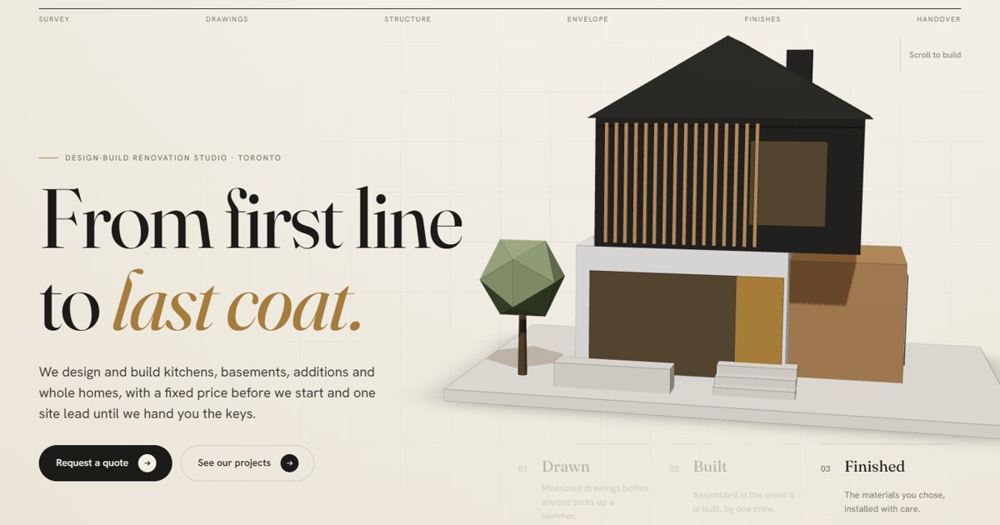

# Halden Row Renovation Studio

Website for a Toronto design-build renovation studio.



## Highlights

- **3D hero that builds itself.** A house modelled in React Three Fiber starts as a line drawing with dimension lines, then assembles part by part in build order as you scroll, and finally takes on real materials.
- **Drawing to built.** A keyboard-accessible comparison slider on every project, plus a cursor "lens" on the home page that reveals the design drawing under each photo.
- **Quote planner.** A five-step request flow with live planning ranges, photo uploads resized in the browser, validation shared between client and server (Zod), a honeypot field and a clear "request, not a booking" confirmation.
- **Motion.** Framer Motion reveals, split-text headings, parallax images, a scroll-driven horizontal process section, shared-layout filter chips and page transitions. Everything respects `prefers-reduced-motion`.
- **Projects.** Filterable index (filter kept in the URL), static project pages with facts, story, gallery and lightbox.

## Stack

Next.js 16 (App Router) · React 19 · TypeScript · React Three Fiber + drei · Framer Motion · Zod · plain CSS

## Run

```bash
npm install
npm run dev     # http://localhost:5380
npm run build
```

## Structure

```
app/                 pages, metadata, API route (app/api/quote)
components/          Hero, HouseScene (3D), CompareSlider, QuoteWizard, ProjectBrowser, ...
lib/data.ts          studio details, projects, services, process
lib/quote.ts         quote schema, planning-range maths
scripts/sketch.py    turns a photo into a design-drawing image (OpenCV)
```

Photography: see [CREDITS.md](CREDITS.md).
